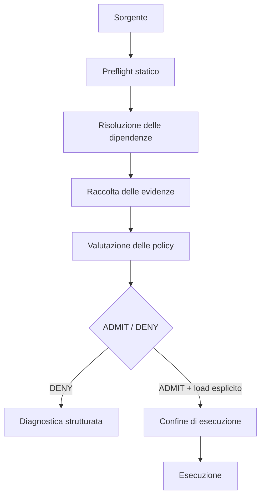

# ImportSpy — Admission Control Python con Policy-as-Code

**Versione documentata: 0.5.0 · 23 settembre 2026.** È l’ultima release elencata su [PyPI](https://pypi.org/project/importspy/) alla verifica del 16 ottobre 2026. La generazione attuale è una pipeline di ammissione *prima* dell’esecuzione, non il vecchio validatore di contratti runtime eseguito intorno all’import.

**Tipo:** strumento open-source per sviluppatori Python<br>
**Ruolo:** creatore e maintainer · architettura e implementazione<br>
**Dominio:** Python · Developer Tooling · Policy-as-Code · Software Supply Chain<br>
**Codice e riferimento aggiornato:** [ImportSpy su GitHub](https://github.com/atellaluca/ImportSpy) · [Rilascio 0.5.0 su PyPI](https://pypi.org/project/importspy/0.5.0/)

ImportSpy decide se un modulo Python e le dipendenze osservate rispettano le policy **prima di ammettere il modulo all’esecuzione**. Ho progettato e implementato la pipeline di admission, dall’ispezione statica e dalla risoluzione delle dipendenze alla diagnostica strutturata e al loader esplicito.

## Il problema: importare significa già eseguire

Un sistema a plugin può importare un modulo per scoprirne le funzioni, ispezionarne le dipendenze o verificarne la compatibilità. A quel punto, Python potrebbe aver già eseguito il codice al livello principale del modulo. Un componente rifiutato può quindi aver prodotto effetti prima che il sistema decida se accettarlo.

ImportSpy è nato per rendere esplicite le assunzioni tra moduli Python. Quel lavoro ha fatto emergere un confine più fondamentale: la validazione successiva all’import non può impedire l’esecuzione già avvenuta. La domanda architetturale è diventata: **come può un sistema Python ragionare su un modulo prima di fidarsi abbastanza da eseguirlo?**

## Cosa è cambiato con la versione 0.5

Le versioni precedenti mettevano al centro contratti dichiarativi e controlli del contesto di importazione. Con la **0.5** ho cambiato il punto di controllo: il sistema esamina un sorgente Python **senza importarlo**, risolve le dipendenze osservate e valuta una policy prima di qualsiasi caricamento esplicito del target.

Non è una semplice rinomina: cambiano il flusso CLI (`init`, `check`), l’API della libreria e il modello di decisione. `check` restituisce `ADMIT` o `DENY` e diagnostica riutilizzabile dalla CI, ma **non esegue** il modulo. L’esecuzione esplicita usa `AdmissionEngine.load(request)` della libreria Python, che ripete l’ammissione prima di eseguire il target.

```bash
pip install importspy
importspy init path/to/plugin.py
# Revisiona il contratto generato
importspy check path/to/plugin.py --format json
```

Il talk del 2025 descrive la prima generazione del progetto: è parte della sua evoluzione, non la documentazione del comportamento della 0.5.

## Decisione architetturale

Ho separato l’ammissione dall’esecuzione. L’ispezione raccoglie fatti; la policy li valuta; il caricamento è un’operazione successiva ed esplicita.



Un `check` autonomo concluso con successo si ferma alla decisione. Non esegue il target e non conferisce un’autorizzazione immutabile a caricarlo in seguito.

## Preflight statico

L’inspector acquisisce i byte del sorgente, ne analizza l’albero sintattico e lo compila per verificare sintassi e regole di scope, senza eseguire il risultato. Sia `check` sia `init` ispezionano il target senza eseguirne il codice al livello principale né importarne le dipendenze osservate. `init` produce una policy iniziale da revisionare, non un’approvazione automatica.

Questo permette di accertare fatti sul sorgente, come dichiarazioni, valori letterali e riferimenti di import. Non dimostra il comportamento arbitrario di codice Python. Decorator, valori calcolati o interfacce costruite dinamicamente possono lasciare sconosciuto un fatto richiesto. In quel caso i vincoli statici obbligatori bloccano l’ammissione, senza eseguire il target per colmare l’incertezza.

## Identità delle dipendenze

Il nome usato nell’import non coincide necessariamente con l’identità del pacchetto a cui applicare la policy:

```text
import yaml → nome di import: yaml → distribuzione: PyYAML
```

Il resolver collega gli import del sorgente ai metadati delle distribuzioni installate. Distingue dipendenze standard library, locali al progetto, installate, namespace, da origine diretta e non risolte; installazione editable e origine VCS/direct URL sono fatti aggiuntivi. Un import namespace può coinvolgere più distribuzioni.

Questa distinzione rende sensate le policy su versioni, dichiarazioni, origine e installazioni editable. Senza di essa, una regola potrebbe riguardare il pacchetto sbagliato o ignorare un’incertezza. L’assenza di metadati sull’origine resta un dato sconosciuto: non prova la provenienza da PyPI. L’inventario copre gli import visibili nel sorgente selezionato, non l’intero grafo delle dipendenze transitive.

## Evidenze, policy e decisione di ammissione

Un contratto YAML esprime requisiti come codice revisionabile: struttura attesa del modulo, regole sulle dipendenze, evidenze richieste e condizioni del runtime host. I controlli implementati sull’host coprono versione Python, sistema operativo, architettura, implementazione dell’interprete e requisiti sull’ambiente. Il contratto può essere versionato con l’applicazione e verificato in CI. Definisce i criteri di ammissione; non riscrive né isola il target.

Le evidenze descrivono ciò che un collector conosce. La policy stabilisce se quella conoscenza è sufficiente. Separarle permette di applicare requisiti diversi alla stessa osservazione, senza nascondere decisioni di policy nella raccolta dei dati.

`Evidence` distingue fatti **verified**, **observed**, **unknown** e **unavailable**. I metadati installati sono osservazioni. “Verified” riguarda il singolo fatto e la procedura usata per verificarlo: non significa che il codice sia sicuro. Un’evidenza obbligatoria sconosciuta o non disponibile non può soddisfare la policy.

Il risultato è una `AdmissionDecision` che contiene esito, identità di sorgente e contratto, dipendenze, evidenze, record `Violation` strutturati e indicazione dell’eventuale esecuzione. I reporter leggibili da persone, JSON e SARIF consumano la stessa decisione. Lo sviluppatore può capire un rifiuto e la CI può elaborarne il risultato senza ripetere l’ispezione.

## L’esecuzione ha una responsabilità separata

`AdmissionEngine.load(request)` aggiorna i metadati delle dipendenze, ripete l’ammissione e, se consentito, esegue i byte del sorgente acquisiti. L’esecuzione resta così legata allo snapshot ispezionato del target, anche se il file cambia durante la raccolta delle evidenze. È un’operazione della libreria, separata dai controlli CLI.

È una garanzia volutamente circoscritta. Dipendenze installate, import hook e ambiente circostante non vengono congelati. Durante l’esecuzione possono ancora avvenire import ordinari e dinamici. I runtime validator opzionali ispezionano gli oggetti inizializzati **dopo l’esecuzione** e non possono annullare gli effetti già prodotti. ImportSpy non è una sandbox e non elimina ogni race tra controllo ed esecuzione.

## Ruolo nella supply chain ed estensioni

ImportSpy trasforma evidenze in una decisione di ammissione. Non sostituisce package manager, vulnerability scanner o generatori di SBOM e non include verifiche OSV o Sigstore. Metadati dei pacchetti e URL di origine non costituiscono provenienza verificata crittograficamente.

Ho separato le estensioni `EvidenceProvider`, `PolicyValidator`, `RuntimeValidator` e `Reporter` per far evolvere indipendentemente raccolta, decisioni, controlli dopo l’esecuzione e presentazione. Questi protocolli sono implementati. Il repository include un [esempio offline di provider e validator](https://github.com/atellaluca/ImportSpy/blob/main/docs/extensions.md); il codice di esempio è separato dal pacchetto installato e non verifica attestazioni esterne sulla supply chain.

Gli adattatori per risultati di vulnerabilità, Sigstore, attestazioni PyPI e inventari SBOM sono [proposte della roadmap](https://github.com/atellaluca/ImportSpy/blob/main/docs/community-roadmap.md), non integrazioni native. Anche registri organizzativi di policy, dashboard e workflow di approvazione sono sviluppi futuri.

I controlli del core funzionano offline. La raccolta via rete richiede selezione esplicita del provider e autorizzazione. A parità di policy e fatti, la valutazione è deterministica: rendere l’I/O esplicito facilita test e riproducibilità, senza supporre che le evidenze esterne restino sempre uguali.

## Il mio contributo e il risultato

Curo implementazione Python, analisi statica, risoluzione delle dipendenze, modelli di dominio, interfacce di estensione, CLI, reporting, test, documentazione e workflow di rilascio. I test di regressione del progetto verificano il confine di esecuzione anche con sorgenti che tentano output, scritture su file, modifiche all’ambiente, subprocess o operazioni di rete.

Il risultato è una decisione di ammissione ispezionabile e un percorso di esecuzione separato. La lezione progettuale è rendere incertezza e confini di fiducia parte del modello, invece di nasconderli dietro un import riuscito.

Le applicazioni concrete includono ammissione di plugin, piattaforme Python interne, governance delle dipendenze e controlli di policy in CI. Sono scenari d’uso del progetto, non dichiarazioni di adozione in produzione.

## Presentazione pubblica

**GDG Basilicata · Flash Talks Arena · 20 maggio 2025** — *ImportSpy: Quando i moduli Python sanno dire “no”*. Un talk tecnico sulla **prima generazione** di ImportSpy, centrata sui contratti runtime. La versione 0.5 adotta invece preflight statico e admission control prima dell’esecuzione.

[Presentazione originale — Italiano (PDF)](../../assets/talks/importspy-gdg-basilicata-it.pdf) · [Dettagli dell’evento e del talk](https://gdg.community.dev/events/details/google-gdg-basilicata-presents-flash-talks-arena/)

Materiale collegato: [Presentazione tecnica in inglese (PDF)](../../assets/talks/importspy-runtime-contract-validation-en.pdf).

## Approfondisci il lavoro tecnico

- [Architettura: evidenze, policy e confine di esecuzione](architecture.md)
- [Repository, test e contributi al progetto](https://github.com/atellaluca/ImportSpy)
- [Migrazione dalla 0.4](https://github.com/atellaluca/ImportSpy/blob/main/docs/migration-0.5.md) · [Modello di sicurezza e limiti](https://github.com/atellaluca/ImportSpy/blob/main/docs/security-model.md)
- [Documentazione aggiornata per la 0.5 nel repository](https://github.com/atellaluca/ImportSpy/tree/main/docs) · [Release 0.5.0 su PyPI](https://pypi.org/project/importspy/0.5.0/)
- [Tutti i casi studio](../index.md)

[Profilo tecnico](../../profile.md) · [CV](../../cv.md) · [Parliamo di un’opportunità](../../contact.md)
