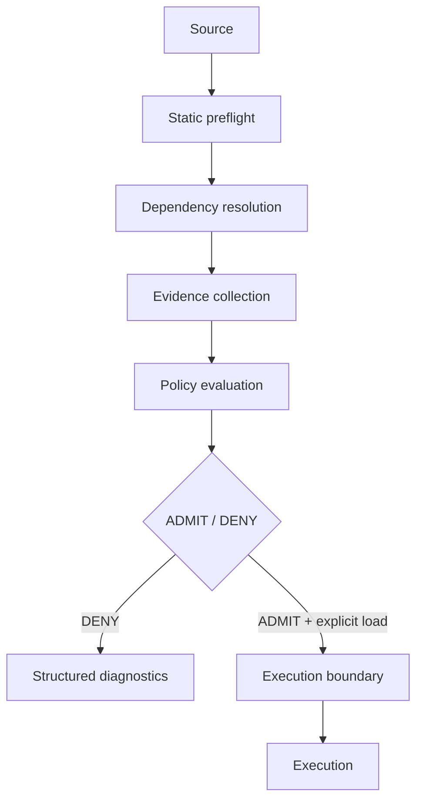

# ImportSpy — Python Admission Control with Policy-as-Code

**Version covered: 0.5.0 · September 23, 2026.** This is the latest release listed on [PyPI](https://pypi.org/project/importspy/) as of October 16, 2026. The current generation is an admission pipeline *before* execution, not the earlier runtime-contract validator wrapped around importing.

**Type:** open-source Python developer tooling<br>
**Role:** creator and maintainer · architecture and implementation<br>
**Domain:** Python · Developer Tooling · Policy-as-Code · Software Supply Chain<br>
**Current source and reference:** [ImportSpy on GitHub](https://github.com/atellaluca/ImportSpy) · [0.5.0 on PyPI](https://pypi.org/project/importspy/0.5.0/)

ImportSpy decides whether a Python module and its observed dependencies satisfy policy **before admitting the module for execution**. I designed and implemented the admission pipeline, from static inspection and dependency resolution to structured diagnostics and an explicit loader.

## The problem: importing is already execution

A plugin host may import a module to discover its functions, inspect its dependencies or check compatibility. By then, Python may already have run the module's top-level code. A rejected component can therefore have produced effects before the host decides whether it belongs in the system.

ImportSpy started by making assumptions between Python modules explicit. That work exposed a more fundamental boundary: validation performed after import cannot prevent earlier execution. The architectural question became: **how can a Python system reason about a module before trusting it enough to execute it?**

## What changed in version 0.5

Earlier releases centered on declarative contracts and checks around the importing context. In **0.5** I moved the decision boundary: ImportSpy inspects Python source **without importing it**, resolves observed dependencies and evaluates policy before any explicit target load.

This is more than a rebrand. The CLI workflow (`init`, `check`), library API and decision model have changed. `check` returns `ADMIT` or `DENY` with CI-friendly diagnostics, but **does not execute** the module. Explicit execution uses the Python library's `AdmissionEngine.load(request)`, which performs fresh admission before running the target.

```bash
pip install importspy
importspy init path/to/plugin.py
# Review the generated contract
importspy check path/to/plugin.py --format json
```

The 2025 talk explains the earlier generation. It remains project history—not documentation of how 0.5 behaves.

## Architectural decision

I separated admission from execution. Inspection gathers facts; policy evaluates those facts; loading is an explicit later operation.



A successful standalone `check` stops at the decision. It does not execute the target and does not grant immutable permission to load it later.

## Static preflight

The inspector captures the source bytes, parses the syntax tree and compiles it to check syntax and scope rules without executing the result. Both `check` and `init` inspect the target without running its top-level code or importing its observed dependencies. `init` produces a starter policy for the developer to review, not an automatic approval.

This establishes source-level facts such as declarations, literal values and import references. It cannot prove arbitrary Python behavior. Decorators, computed values or dynamically built interfaces may leave a required fact unknown. Required static constraints then fail closed instead of executing the target to fill the gap.

## Dependency identity

An import name is not necessarily the package identity used by policy:

```text
import yaml → import name: yaml → distribution: PyYAML
```

The resolver connects source imports to installed distribution metadata. It distinguishes standard-library, project/local, installed, namespace, direct-origin and unresolved dependencies; editable installation and VCS/direct-URL origin are additional facts. Namespace imports may have several distribution contributors.

That distinction makes version, declaration, origin and editable-install policies meaningful. Otherwise, a rule could be applied to the wrong package or silently overlook uncertainty. Missing origin metadata remains unknown; it does not prove that a package came from PyPI. The inventory covers imports visible in the selected source, not a complete transitive dependency graph.

## Evidence, policy and the admission decision

A YAML contract expresses requirements as reviewable code: expected module structure, dependency rules, required evidence and host runtime conditions. Implemented host checks cover Python version, operating system, architecture, interpreter implementation and environment requirements. The contract can be versioned with the application and checked in CI. It defines the admission criteria; it does not rewrite or isolate the target.

Evidence records what a collector knows. Policy decides whether that knowledge is sufficient. Keeping them separate lets the same observation support different application requirements without hiding policy inside the collector.

`Evidence` distinguishes **verified**, **observed**, **unknown** and **unavailable** facts. Installed metadata is an observation. “Verified” applies to the specific fact and verification procedure; it is never a statement that the code is safe. Required evidence that is unknown or unavailable cannot satisfy policy.

The result is an `AdmissionDecision` containing the outcome, source and contract identity, dependencies, evidence, structured `Violation` records and whether execution occurred. Human-readable, JSON and SARIF reporters consume the same decision. Developers can diagnose a denial while CI receives machine-readable results without rerunning inspection.

## Execution is a separate responsibility

`AdmissionEngine.load(request)` refreshes dependency metadata, performs fresh admission and, if admitted, executes the captured source bytes. This keeps execution tied to the inspected target snapshot even if the file changes during collection. It is a library operation, separate from the CLI checks.

That is a deliberately bounded guarantee. Installed dependencies, import hooks and the surrounding environment are not frozen. Ordinary and dynamic imports can still run during execution. Optional runtime validators inspect initialized objects **after execution** and cannot undo top-level effects. ImportSpy is not a sandbox and does not eliminate every check-to-execution race.

## Supply-chain role and extension design

ImportSpy turns evidence into an admission decision. It does not replace a package manager, vulnerability scanner or SBOM generator, and does not bundle OSV or Sigstore verification. Package metadata and origin URLs are not cryptographic provenance.

I separated `EvidenceProvider`, `PolicyValidator`, `RuntimeValidator` and `Reporter` extension points so that collection, decisions, post-execution checks and presentation can evolve independently. These protocols are implemented. The repository includes an [offline provider and validator example](https://github.com/atellaluca/ImportSpy/blob/main/docs/extensions.md); example code is separate from the installed package and does not verify external supply-chain claims.

Adapters for vulnerability results, Sigstore, PyPI attestations and SBOM inventories are [roadmap proposals](https://github.com/atellaluca/ImportSpy/blob/main/docs/community-roadmap.md), not built-in integrations. Organizational policy registries, dashboards and approval workflows are also future work.

Core checks work offline. Network collection requires explicit provider selection and authorization. With fixed policy and facts, evaluation is deterministic; making I/O explicit helps testing and reproducibility without pretending that external evidence never changes.

## My contribution and outcome

I own the Python implementation, static analysis, dependency resolution, domain models, extension interfaces, CLI, reporting, tests, documentation and release workflow. Regression tests in the project exercise the execution boundary, including source that attempts output, file writes, environment changes, subprocesses or network operations.

The result is an inspectable admission decision and a separate execution path. The engineering lesson is to make uncertainty and trust boundaries part of the model rather than hide them behind a successful import.

Concrete applications include plugin admission, internal Python platforms, dependency governance and CI policy checks. These are use cases for the design, not claims of production adoption.

## Public presentation

**GDG Basilicata · Flash Talks Arena · 20 May 2025** — *ImportSpy: Quando i moduli Python sanno dire “no”*. A technical talk about the **earlier generation** of ImportSpy and its runtime contracts. Version 0.5 now uses static preflight and admission control before execution.

[Original presentation — Italian (PDF)](../../assets/talks/importspy-gdg-basilicata-it.pdf) · [Event and talk details](https://gdg.community.dev/events/details/google-gdg-basilicata-presents-flash-talks-arena/)

Related material: [English technical presentation (PDF)](../../assets/talks/importspy-runtime-contract-validation-en.pdf).

## Explore the engineering

- [Architecture: evidence, policy and execution boundaries](architecture.md)
- [Repository, tests and contribution work](https://github.com/atellaluca/ImportSpy)
- [Migration from 0.4](https://github.com/atellaluca/ImportSpy/blob/main/docs/migration-0.5.md) · [Security model and limits](https://github.com/atellaluca/ImportSpy/blob/main/docs/security-model.md)
- [Version 0.5 documentation in the repository](https://github.com/atellaluca/ImportSpy/tree/main/docs) · [PyPI release 0.5.0](https://pypi.org/project/importspy/0.5.0/)
- [All case studies](../index.md)

[Technical profile](../../profile.md) · [CV](../../cv.md) · [Discuss an opportunity](../../contact.md)
